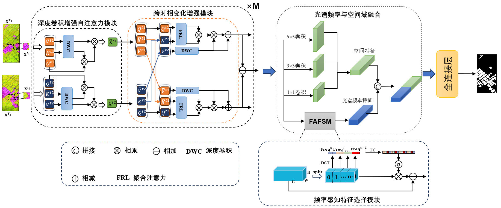

构建深度卷积增强自注意力模块，将局部空间信息引入自注意力计算，联合提取单时相图像的局部结构与全局上下文特征。其次，引入双向跨时相聚焦注意力，通过聚焦映射与交叉特征聚合挖掘双时相关联，并利用深度卷积分支补充局部信息；将自注意力与跨时相交互单元堆叠两轮，逐步细化双时相特征。最后，对交互后的特征进行差分，并构建空间与频率融合模块。该模块通过基于分组离散余弦变换的自适应频率感知通道注意力，动态关注包含微弱变化语义的通道，挖掘具有潜在变化特征的频率信息；同时，利用多尺度卷积融合不同邻域范围的空间上下文，捕捉纹理破碎等形态变化，将频率感知通道特征与多尺度空间特征融合，以增强结构变化表征并完成变化判别。
